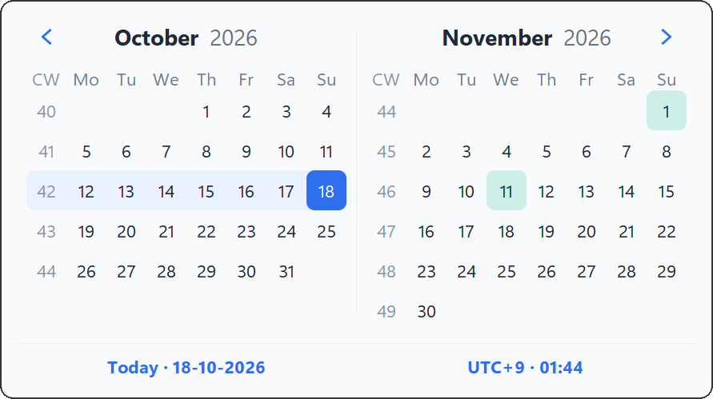
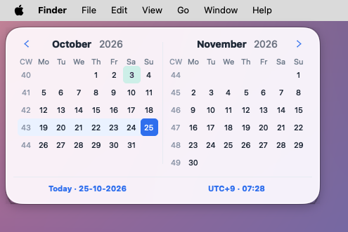
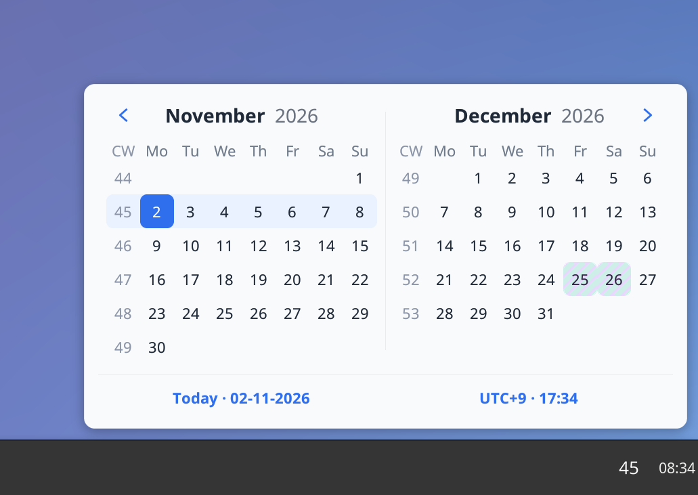
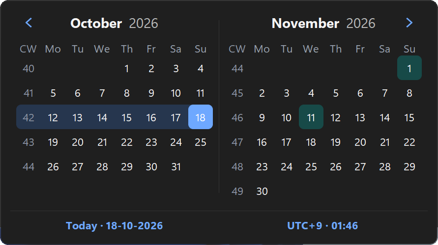
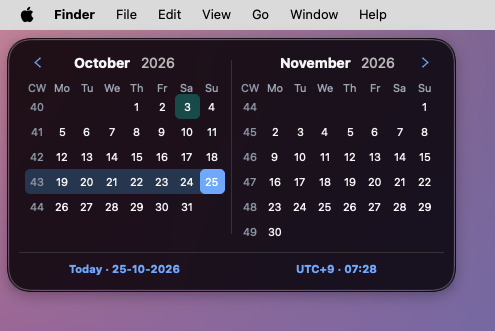
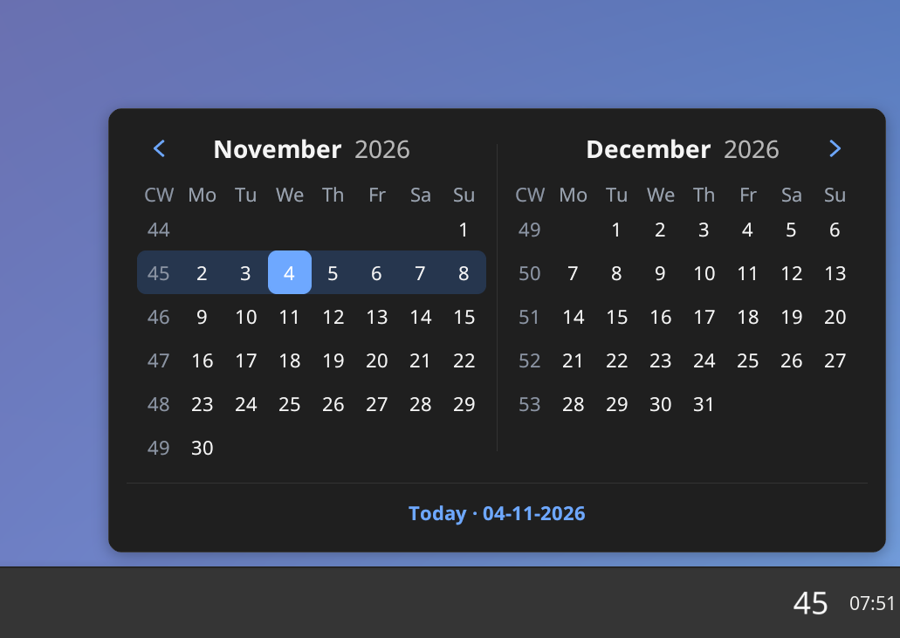

# 📅 WeekNumber 1.0 — the first release written in Rust 🦀

The ISO week number in your taskbar, menu bar or panel, with a two-month calendar, public holidays and a time-zone clock. Now on Windows, macOS and Linux. Small, offline and free. ⚡

| 🪟 Windows | 🍎 macOS | 🐧 Linux |
|:---:|:---:|:---:|
|  |  |  |
|  |  |  |

### 📦 Downloads
| | File |
|---|---|
| 🪟 Windows x64 | `WeekNumber-1.0-windows-x64.exe` |
| 🪟 Windows ARM64 | `WeekNumber-1.0-windows-arm64.exe` |
| 🍎 macOS Apple Silicon | `WeekNumber-1.0-macos-arm64.dmg` |
| 🐧 Linux x64 — Ubuntu, Linux Mint, Debian | `WeekNumber-1.0-linux-x64.deb` |
| 🐧 Linux ARM64 — Ubuntu, Debian, Raspberry Pi OS | `WeekNumber-1.0-linux-arm64.deb` |
| 🐧 Linux x64 — Fedora, openSUSE | `WeekNumber-1.0-linux-x64.rpm` |
| 🐧 Linux ARM64 — Fedora, openSUSE | `WeekNumber-1.0-linux-arm64.rpm` |
| 🐧 Linux x64 — Bazzite, SteamOS (Flatpak) | `WeekNumber-1.0-linux-x64.flatpak` |
| 🐧 Linux ARM64 — Flatpak | `WeekNumber-1.0-linux-arm64.flatpak` |
| 🐧 Linux x64 — any distribution, e.g. Arch | `WeekNumber-1.0-linux-x64.AppImage` |
| 🐧 Linux ARM64 — any distribution | `WeekNumber-1.0-linux-arm64.AppImage` |

> 🪟 First launch on Windows: if SmartScreen shows *Windows protected your PC*, click **More info → Run anyway**.
> 🍎 First launch on macOS: **System Settings → Privacy & Security → Open Anyway**.
> 🐧 Ubuntu, Linux Mint, Debian: double-click the `.deb`; it opens in App Center or Software Manager. Choose **Install**.
> 🐧 Fedora, openSUSE: double-click the `.rpm`; it opens in Software, Discover or YaST. Choose **Install**.
> 🐧 Bazzite, SteamOS (desktop mode): double-click the `.flatpak`; it opens in Discover or your Flatpak app store. Choose **Install** (the Freedesktop runtime comes from Flathub the first time).
> 🐧 Other distributions (AppImage): allow the AppImage to run (Properties → *Allow executing*), then double-click it.

🔒 No network, no accounts, no tracking. A non-profit project, made to make work life a little easier. 💙
