<div align="center">

# 📅 WeekNumber

### The current ISO week number, always one click away. ⚡

A small, offline tray app written in **Rust** for **Windows** 🪟, **macOS** 🍎
and **Linux** 🐧, with week numbers, a calendar, public holidays, time zones
and quick copy actions.

[](https://github.com/Shanko100/ISOWeekNumber/actions/workflows/test-windows.yml)
[](https://github.com/Shanko100/ISOWeekNumber/actions/workflows/test-macos.yml)
[](https://github.com/Shanko100/ISOWeekNumber/actions/workflows/test-linux.yml)

</div>

---

## ✨ Features

- 📌 ISO week number in the Windows notification area, the macOS menu bar or
  the Linux panel
- 🗓️ Two-month calendar with ISO week numbers — on Liquid Glass on macOS 🫧
- 🎉 Public holidays for up to two countries
- 🌍 Time-zone clock with a world map
- 📋 Quick copy of dates and week numbers
- 🎨 Light/dark theme, custom icon colour and bold digits
- 🚀 Optional start at sign-in, the safe way on every platform
- 🪶 One small file (about 1 MB) using about 2 MB of its own memory while
  idle on Windows and Linux (on macOS, AppKit adds its shared baseline)
- 🔒 No network traffic, accounts, tracking or telemetry

## 📸 Preview

| 🪟 Windows | 🍎 macOS (Liquid Glass) | 🐧 Linux |
|:---:|:---:|:---:|
| 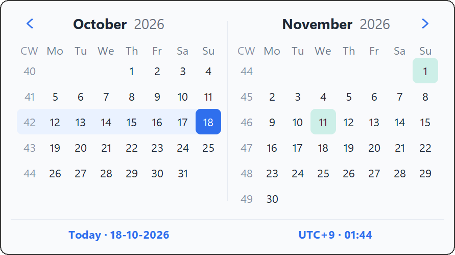 | 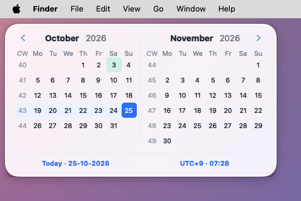 | 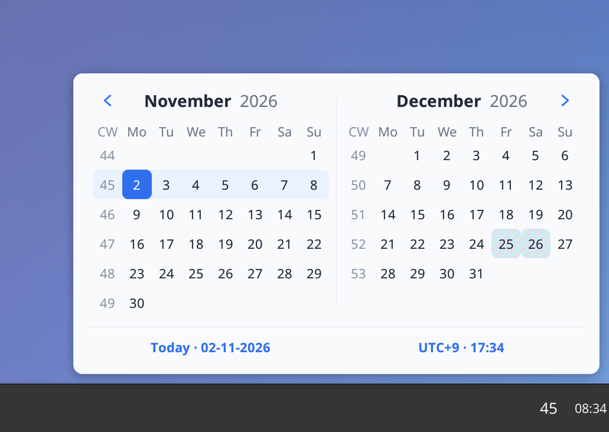 |
| 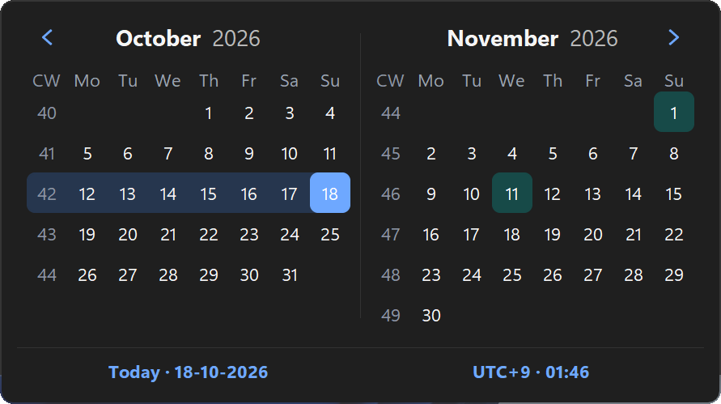 | 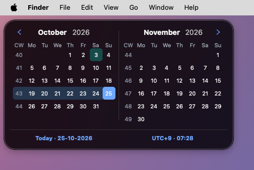 | 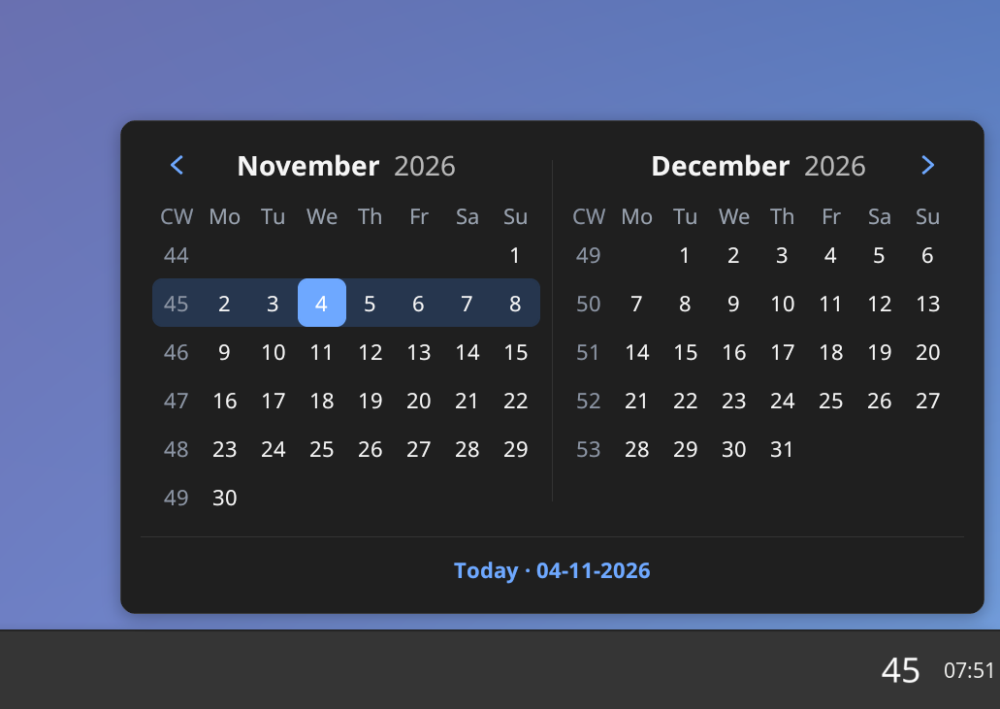 |

<details>
<summary>🪟 More of Windows</summary>
<p align="center">
  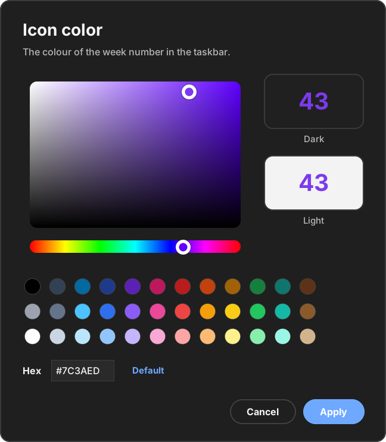
  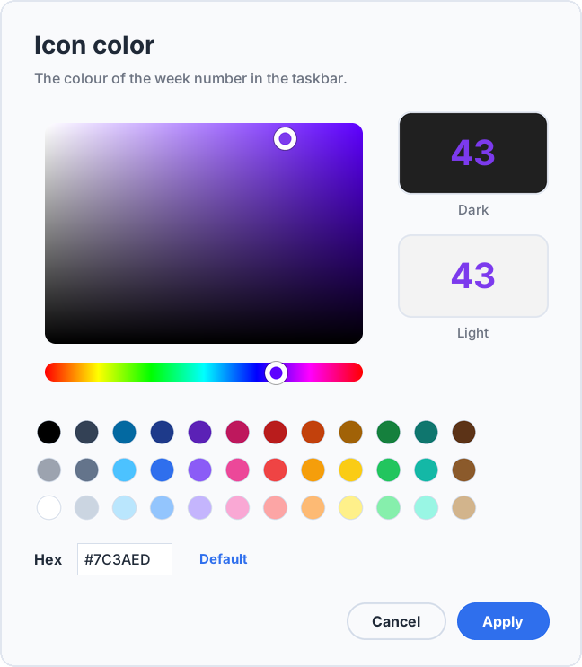
</p>
<p align="center">
  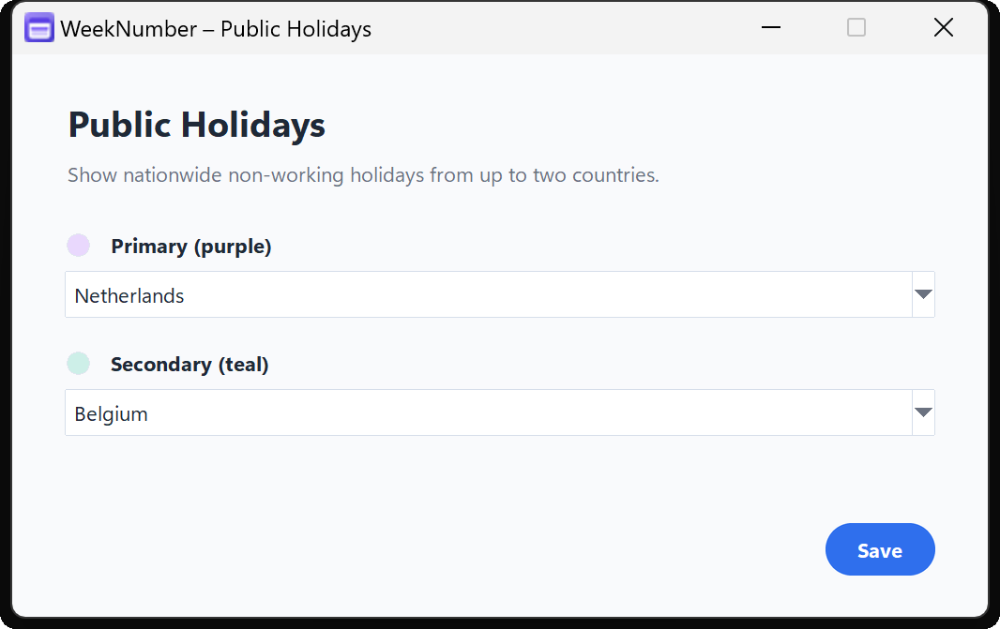
  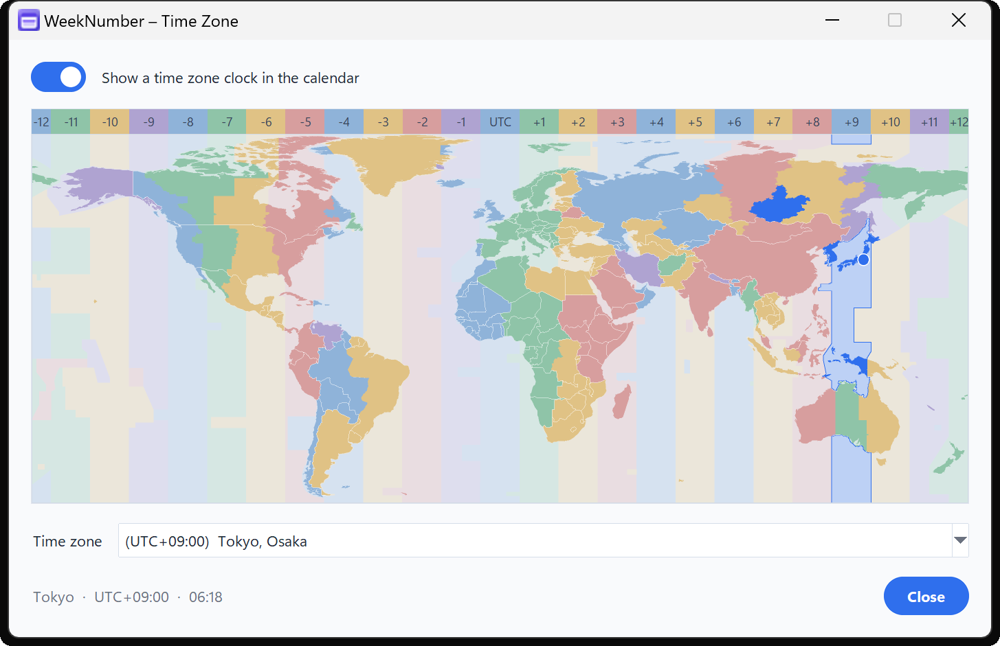
</p>
</details>

<details>
<summary>🍎 More of macOS</summary>
<p align="center">
  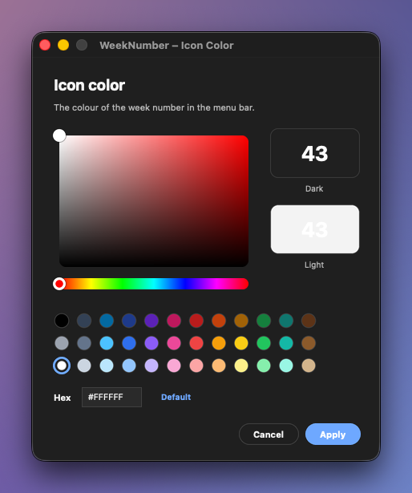
  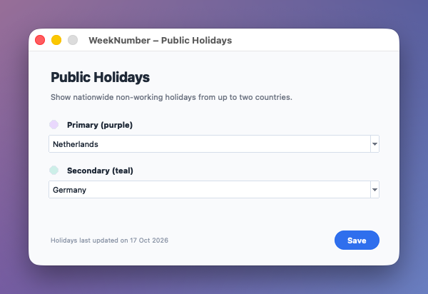
</p>
<p align="center">
  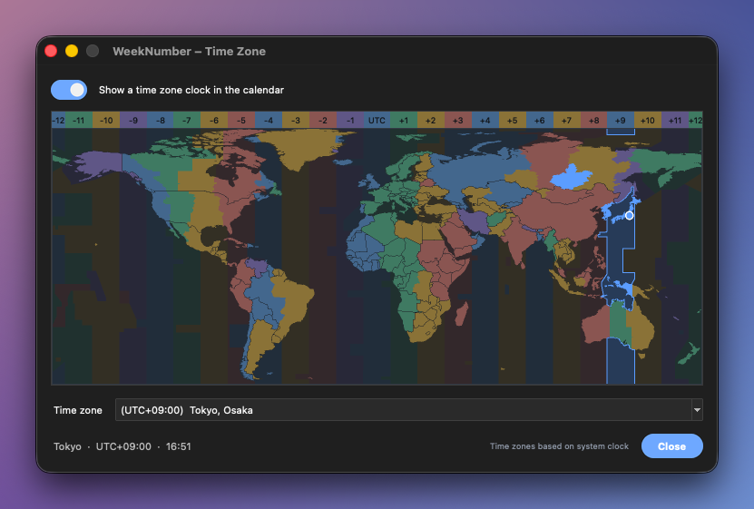
  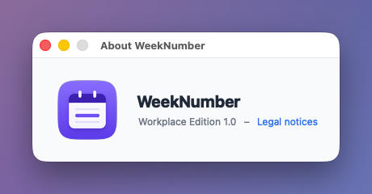
</p>
</details>

<details>
<summary>🐧 More of Linux</summary>
<p align="center">
  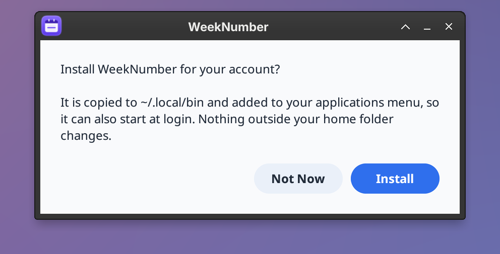
  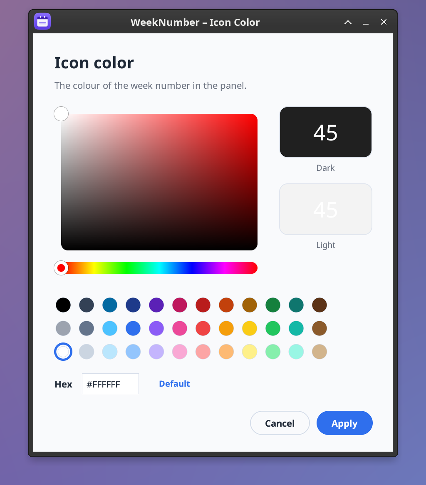
</p>
<p align="center">
  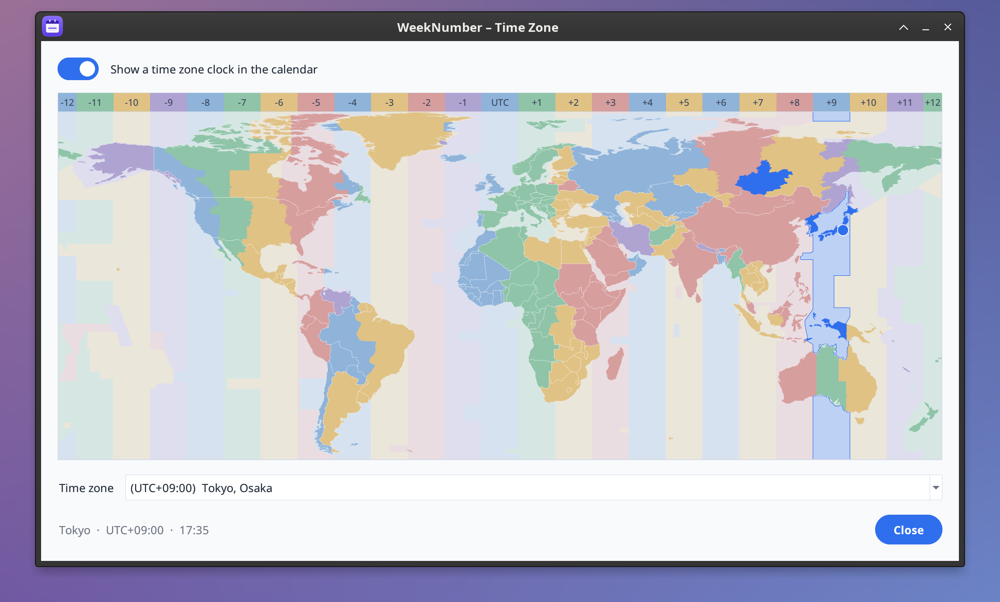
  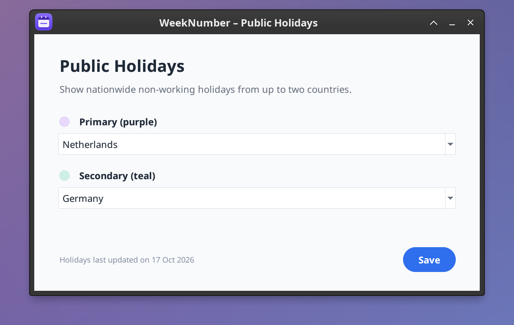
</p>
</details>

## 📦 Editions

| Edition | File | Runs on |
|---|---|---|
| 🪟 Windows x64 | `WeekNumber-1.0-windows-x64.exe` | Windows 10 and 11, x64 |
| 🪟 Windows ARM64 | `WeekNumber-1.0-windows-arm64.exe` | Windows 11 on ARM (native) |
| 🍎 macOS | `WeekNumber-1.0-macos-arm64.dmg` | macOS 13 or later, Apple silicon |
| 🐧 Linux x64 | `WeekNumber-1.0-linux-x64.AppImage` | Ubuntu, Linux Mint, Fedora, Bazzite, SteamOS, Arch, Debian, openSUSE… |
| 🐧 Linux ARM64 | `WeekNumber-1.0-linux-arm64.AppImage` | Any ARM64 distribution (Raspberry Pi OS 64-bit, Asahi, …) |

Every edition is a single program with everything built in: no installer,
no runtime, no libraries to add. The Linux AppImage needs no FUSE either —
it is the statically linked program itself, so the same file runs on every
distribution, including immutable ones like Bazzite and SteamOS.

## 🚀 Install

### 🪟 Windows

1. Download `WeekNumber-1.0-windows-x64.exe` (or `-arm64.exe` for Windows on
   ARM).
2. Preferably place it in `C:\Program Files\WeekNumber` or
   `%LOCALAPPDATA%\Programs\WeekNumber`.
3. Start it.

### 🍎 macOS

1. Open `WeekNumber-1.0-macos-arm64.dmg` and drag **WeekNumber** to
   **Applications**.
2. Open WeekNumber from Applications. The week number appears in the menu
   bar; the app has no Dock icon.
3. If macOS says it can't check the app, open **System Settings → Privacy &
   Security** and choose **Open Anyway** (builds without a Developer ID
   certificate are signed ad hoc).

### 🐧 Linux

1. Download `WeekNumber-1.0-linux-x64.AppImage` (or `-arm64`).
2. Allow it to run: right-click → **Properties → Permissions → Allow
   executing file as program** (or `chmod +x`). Then double-click it.
3. WeekNumber offers to **install** itself for your account: the program goes
   to `~/.local/bin`, with a menu entry and sharp icons — nothing outside
   your home folder, no password. Choose **Not Now** to just run it.

The icon appears in the panel's tray: KDE Plasma (also SteamOS desktop
mode and Bazzite), Cinnamon (Linux Mint), Xfce, MATE, LXQt, Budgie and
wlroots panels, on X11 and on Wayland through XWayland. On GNOME (Ubuntu,
Fedora Workstation) the **AppIndicator and KStatusNotifierItem Support**
extension shows tray icons; Ubuntu has it on by default. AppImage managers
such as Gear Lever and AppImageLauncher work too.

From a terminal: `WeekNumber-1.0-linux-x64.AppImage --install`, and later
`weeknumber --uninstall`.

> **Run at Startup** is refused from places where someone else could swap the
> program: downloads, desktop, temporary or cloud-synced folders, disk images,
> network shares, removable drives, and folders other users can write to.

## 🖱️ Usage

| Action | Result |
|---|---|
| Click the tray / menu bar icon | Open or close the calendar |
| Right-click the icon | Settings and actions |
| Mouse wheel, trackpad or arrow keys | Browse months |
| Right-click a date or week number | Copy the value |

| Platform | Settings | Run at Startup |
|---|---|---|
| 🪟 Windows | `%LOCALAPPDATA%\WeekNumber\settings.json` | `HKCU\…\Run` value `WeekNumber` |
| 🍎 macOS | `~/Library/Application Support/WeekNumber/settings.json` | Login item (System Settings → General → Login Items) |
| 🐧 Linux | `~/.config/weeknumber/settings.json` | `~/.config/autostart/weeknumber.desktop` |

## 🧪 Tests

Every push to main and every pull request runs the test workflows on real
desktops, on each architecture: formatting, linting, the unit tests, and UI
tests of the release build that click through the app the way a user does.
Screenshots of every window are attached to each run.

| Workflow | Runs on | What the UI tests do |
|---|---|---|
| ⚙️ `test-windows.yml` | Windows x64, Windows 11 ARM64 | First run, calendar placement and keys, every dialog in both themes, tray menu, single instance, Run at Startup off by default, memory |
| ⚙️ `test-macos.yml` | macOS 15, macOS 26 (Liquid Glass) | First run, menu bar item, calendar on glass under the item, the menu and every dialog in both themes, single instance, memory |
| ⚙️ `test-linux.yml` | Ubuntu x64, Ubuntu ARM64, on Xfce at 200 % | AppImage contents, install by double-click, tray click, calendar keys, panel menu, Run at Startup (and its refusal from Downloads), every dialog, single instance, uninstall, memory |

## 🛠️ Build

Each edition has its own release workflow. Open **Actions**, pick the
workflow and choose **Run workflow**; the files appear as downloads on the
run.

| Workflow | Builds | Checks |
|---|---|---|
| ⚙️ `build-windows-x64.yml` | `WeekNumber-1.0-windows-x64.exe` | ASLR, DEP, CFG, CET, static CRT, no network DLLs, manifest, smoke test |
| ⚙️ `build-windows-arm64.yml` | `WeekNumber-1.0-windows-arm64.exe` | ASLR, DEP, CFG, ARM64 machine, static CRT, no network DLLs, manifest, smoke test |
| ⚙️ `build-macos.yml` | `WeekNumber-1.0-macos-arm64.dmg` | arm64 only, PIE, hardened runtime, signature, system libraries only, smoke test |
| ⚙️ `build-linux.yaml` | `WeekNumber-1.0-linux-x64.AppImage`, `-linux-arm64.AppImage` | static-pie, no loader or libraries, full RELRO, NX stack, AppImage payload, tray smoke test |

All of them run `cargo fmt`, `clippy` with warnings as errors, the unit tests
and the cargo-deny dependency audit first. The macOS workflow signs and
notarizes with a Developer ID when the repository has the signing secrets
(see the comments at the top of `build-macos.yml`). `screenshots.yml`
refreshes the pictures above.

Locally:

```sh
cargo test --locked
cargo build --release --locked --target x86_64-pc-windows-msvc    # Windows x64
cargo build --release --locked --target aarch64-pc-windows-msvc   # Windows ARM64
cargo build --release --locked --target aarch64-apple-darwin      # macOS
cargo build --release --locked --target x86_64-unknown-linux-musl # Linux x64
packaging/linux/make-appimage.sh target/x86_64-unknown-linux-musl/release/WeekNumber WeekNumber.AppImage
```

The Rust toolchain is pinned in `rust-toolchain.toml`.

## 🗂️ Structure

```text
.
├── .github/workflows/   ⚙️ Release builds and tests per edition
├── assets/              📦 Icons, holidays, time zones, macOS Info.plist
├── docs/                📚 Administration guide and screenshots
├── legal/               ⚖️ Legal notices and licenses
├── packaging/linux/     🐧 AppImage assembly
├── src/
│   ├── os/              🧩 Platform layer: win32, macos, linux, shared unix
│   ├── startup/         🚀 Run at Startup per platform
│   └── ui/              🎨 Calendar, menus and dialogs (shared)
├── tests/               🧪 UI tests per platform
├── Cargo.toml
├── Cargo.lock
└── README.md
```

The calendar, menus and dialogs are shared by every edition; only the thin
`os` layer differs. It talks to each system directly: Win32 on Windows,
AppKit and Core Text on macOS, and the X11 protocol, D-Bus and the system's
TrueType fonts on Linux — no GUI toolkit, no framework.

## 🔐 Security

WeekNumber runs as the signed-in user without elevation, contains no network
code and starts no child processes. Every input it reads — settings, font
files, time-zone files, X11 and D-Bus messages — is size-checked and
validated. The Linux install writes only to your home folder, through new
files renamed into place, never through links someone left there. Each
build workflow checks the binary's hardening before it is published.

## ⚖️ Legal

WeekNumber is a not-for-profit project under the MIT License. Each edition
shows only the notices and licenses of what it contains, under
**About → Legal notices**.

## 📚 Documentation

- 🏢 [Administration guide](docs/ADMINISTRATION.md)
- 📝 [Changelog](CHANGELOG.md)
