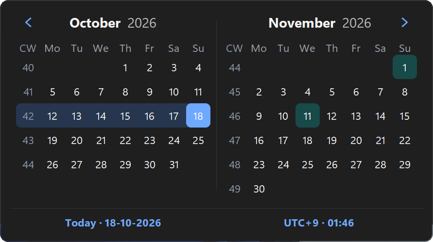
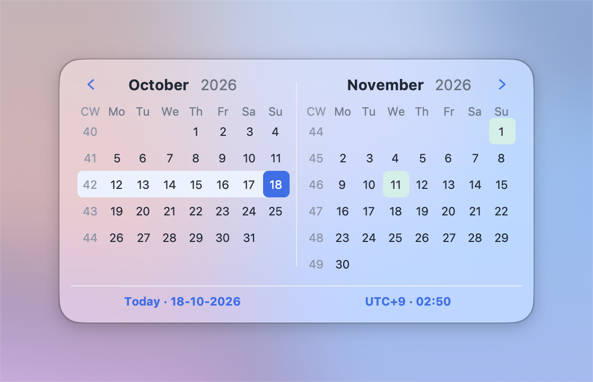
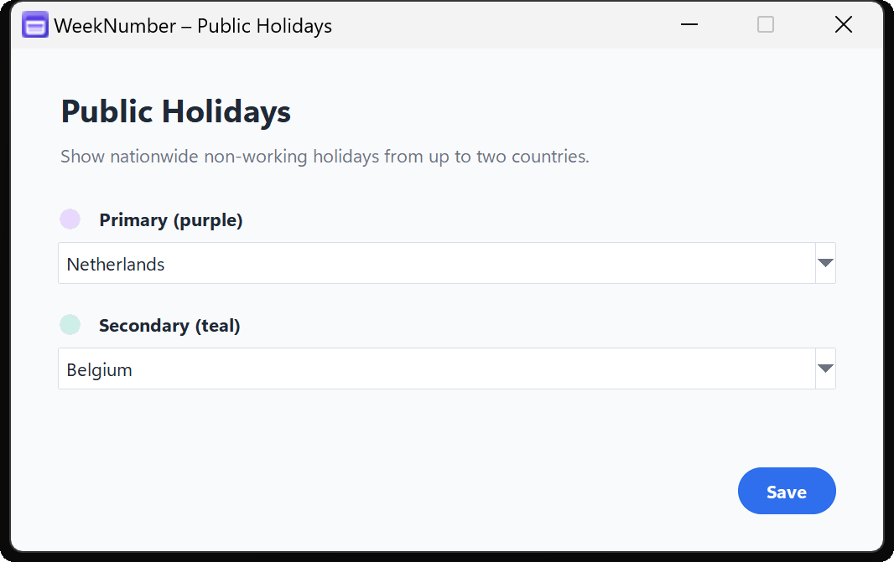
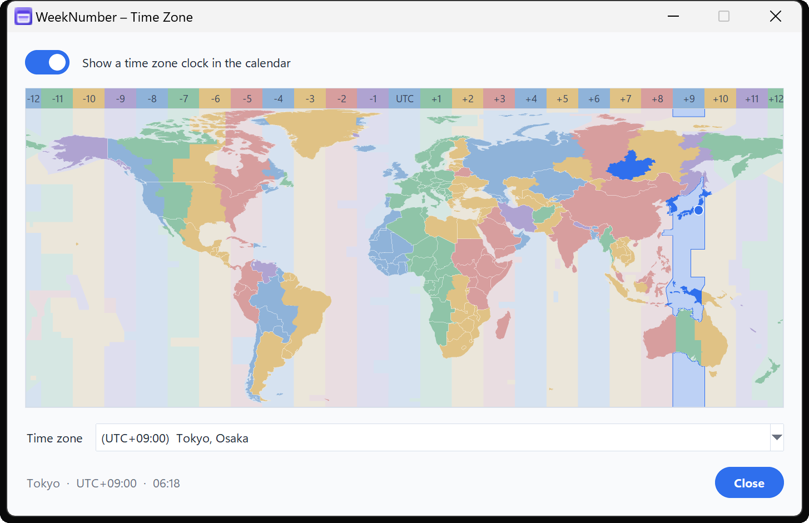
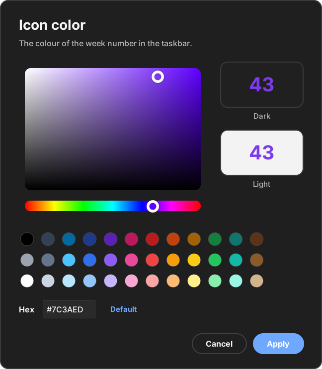
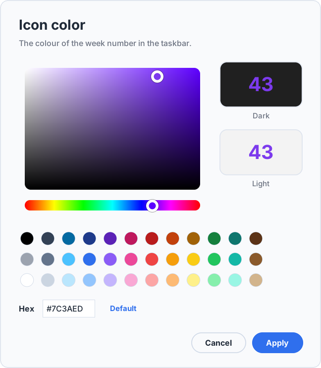

<div align="center">

# 📅 WeekNumber

### Your current ISO week, always one click away. ⚡

A featherweight tray calendar for **Windows** 🪟 and **macOS** 🍎 with ISO week
numbers, public holidays, time-zone context, quick copy actions and a clean,
native feel.

[](https://github.com/Shanko100/ISOWeekNumber/releases)
[](https://github.com/Shanko100/ISOWeekNumber/actions)
[](#-requirements)
[](LICENSE)

**“What week is it?”** — answered before you finish asking. 🙌

</div>

---

## ✨ Highlights

| | Feature | What it does |
|---|---|---|
| 📌 | **Always there** | The current ISO week sits right in the Windows tray or the macOS menu bar. |
| 🗓️ | **Two-month calendar** | One click opens a polished, DPI-sharp calendar; one more click closes it. |
| 🔢 | **ISO-8601 weeks** | Consistent week numbers and ISO week-years, even across New Year. |
| 🎉 | **Public holidays** | Highlights nationwide holidays for up to two countries at once. |
| 🌍 | **Time-zone view** | Adds a clock for any city, picked from a colourful world map. |
| 📋 | **Quick copy** | Right-click a date or a week number to copy it. |
| 🎨 | **Make it yours** | Your own icon colour (with a picker that matches the app), bold digits, light or dark mode. |
| 🪶 | **Featherweight** | Loads only the tray at startup and hands memory back after every window closes. |
| 🚀 | **Run at startup** | Starts for the current user — from a safe install location only. |
| 📦 | **Offline-first** | Holiday and time-zone data ship with the app. No account, no tracking. |

## 📸 Preview

<table>
  <tr>
    <td align="center">
      <br>
      <sub><b>🪟 Windows · Dark mode</b></sub>
    </td>
    <td align="center">
      <br>
      <sub><b>🍎 macOS · Light mode</b></sub>
    </td>
  </tr>
  <tr>
    <td align="center">
      <br>
      <sub><b>🎉 Public holidays</b></sub>
    </td>
    <td align="center">
      <br>
      <sub><b>🌍 Time-zone view</b></sub>
    </td>
  </tr>
  <tr>
    <td align="center">
      <br>
      <sub><b>🎨 Colour picker · Dark mode</b></sub>
    </td>
    <td align="center">
      <br>
      <sub><b>🎨 Colour picker · Light mode</b></sub>
    </td>
  </tr>
</table>

## 🚀 Install

### 🪟 Windows

1. Open the [GitHub Releases](https://github.com/Shanko100/ISOWeekNumber/releases) page.
2. Download **`WeekNumber.exe`** from the latest release.
3. Move it to one of these locations:
   - 🏢 `C:\Program Files\WeekNumber` — needs administrator rights.
   - 👤 `%LOCALAPPDATA%\Programs\WeekNumber` — works without administrator rights.
4. Launch it. 🎊 The week number appears in the notification area.

> [!TIP]
> No Python installation is needed for the packaged executable.

> [!IMPORTANT]
> **Run at Startup** is refused when WeekNumber runs from Downloads, the Desktop,
> a temporary or cloud-synced folder, a network share or a removable drive.
> This stops another person or program from silently replacing the executable.

> [!WARNING]
> 🛡️ **Microsoft Defender SmartScreen**
>
> If SmartScreen appears, **verify that the file came from the
> [official GitHub release](https://github.com/Shanko100/ISOWeekNumber/releases)
> before choosing More info → Run anyway**.
>
> **Do not bypass SmartScreen if you cannot verify where the file came from.**

### 🍎 macOS

1. Download **`WeekNumber.dmg`** from the latest release.
2. Open the disk image.
3. Drag **`WeekNumber.app`** to **Applications**.
4. Launch it. 🎊 The week number appears in the menu bar; the app has no Dock icon.

The current packaged app needs **macOS 12 or newer on Apple silicon**.

> [!NOTE]
> The app is not notarized yet. If macOS blocks the first launch, open
> **System Settings → Privacy & Security** and choose **Open Anyway**.
> On macOS 14 and earlier, Control-click the app and choose **Open**.

## 🖱️ Using WeekNumber

| Action | Result |
|---|---|
| 👆 **Left-click** the tray icon or menu-bar number | Refresh and open the calendar; click again to close it |
| 🖱️ **Right-click** it — or Control-click on macOS | Settings and app actions |
| 🛞 **Mouse wheel** or ⬅️ ➡️ **arrow keys** | Move through the months |
| 📋 **Right-click a date** | Copy the formatted date |
| 🔢 **Right-click a week number** | Copy the ISO calendar week |

The menu has controls for startup, typography, colour, theme, holidays, time
zones, About and Exit. Settings are saved automatically for the current user.
On macOS, the default white colour follows the menu bar's own text colour.

> [!TIP]
> 🎨 **Change Color…** opens WeekNumber's own colour picker with 36 standard
> colours, a hex field and a live preview on a dark and a light taskbar.
> ⚖️ **About → Legal notices** shows the legal notices — license, trademarks,
> privacy, encryption — and every license the build carries, right in the app.

## 🪶 Light by design

WeekNumber runs all day, so it tries hard to stay out of your way:

- 🧊 **Lean start** — only the tray icon is loaded at launch. The calendar,
  dialogs and the time-zone map load the moment you open them.
- 🧹 **Clean exits** — when the last window closes, its code and data leave
  memory again, and the freed memory goes back to the system.
- 🗂️ **Just enough data** — the calendar reads only the holiday years on
  screen, and the world map only exists while a map window is open.
- ⚡ **Still instant** — reopening anything takes a few milliseconds.

## ⚙️ Requirements

### 📦 Packaged application

- **Windows:** Windows 10 or 11 on x64, and Windows 11 on ARM — the x64
  build runs there with every feature; a native ARM64 build works too,
  without encrypted chat
- **macOS:** macOS 12 or newer on Apple silicon

### 🐍 Running from source

- Windows 10/11 or macOS 12+
- Python 3.11+
- On macOS: a python.org Python build with Tk 8.6

## 🧑‍💻 Run from source

<details open>
<summary><strong>🪟 Windows</strong></summary>

```powershell
py -3.11 -m venv .venv
.venv\Scripts\python -m pip install --upgrade pip
.venv\Scripts\python -m pip install -r requirements-dev.txt
.venv\Scripts\python src\weeknumber\weeknumber.py
```

</details>

<details>
<summary><strong>🍎 macOS</strong></summary>

```sh
python3 -m venv .venv
.venv/bin/python -m pip install --upgrade pip
.venv/bin/python -m pip install -r requirements-dev.txt
.venv/bin/python src/weeknumber/weeknumber.py
```

</details>

## 🧪 Tests

Run the complete test suite:

```powershell
.venv\Scripts\python -m pytest
```

On macOS or another POSIX shell:

```sh
.venv/bin/python -m pytest
```

✅ The suite runs on Windows and macOS. Core, data, time-zone, memory and
network-protocol tests are portable; macOS backend tests are skipped on Windows.

## 📦 Build release artifacts

<details>
<summary><strong>🪟 Build the Windows executable</strong></summary>

Create a clean environment with the pinned release dependencies:

```powershell
py -3.11 -m venv .venv-build
.venv-build\Scripts\python -m pip install --upgrade pip
.venv-build\Scripts\python -m pip install -r requirements-release.txt
.venv-build\Scripts\activate
cd src\weeknumber
build_exe.bat --nopause
```

The executable is written to:

```text
src\weeknumber\dist\WeekNumber.exe
```

The exe matches the Python that builds it: x64 Python gives an x64 exe
(which also runs on Windows 11 on ARM), ARM64 Python a native ARM64 exe
without encrypted chat. 32-bit Python is refused.

For a public release, use `requirements-release.txt` rather than
`build_exe.bat --venv`; the release requirements pin exact dependency versions.
Complete the [binary release checklist](docs/BINARY_RELEASE_CHECKLIST.md) before
publishing.

</details>

<details>
<summary><strong>🍎 Build the macOS application</strong></summary>

```sh
python3 -m venv .venv-build
.venv-build/bin/python -m pip install -r requirements-release.txt
cd src/weeknumber
PYTHON=../../.venv-build/bin/python ./build_app.sh
```

Use an arm64 Python (python.org's universal2 installer or Homebrew on Apple
silicon) for a native Apple silicon app; the script says which it built.

The ad-hoc signed bundle is written to
`src/weeknumber/dist/WeekNumber.app`, and the distributable disk image to
`src/weeknumber/dist/WeekNumber.dmg`.

Sign the app with a Developer ID and notarize it before public distribution.

</details>

<details>
<summary><strong>🖼️ Icons</strong></summary>

`app.ico` carries a frame for every size Windows asks for between 100 % and
300 % display scaling, which keeps the taskbar icon sharp. To add missing
sizes without touching the artwork:

```sh
python src/weeknumber/generate_icons.py --add-frames
```

</details>

## 🗂️ Project structure

```text
ISOWeekNumber/
├── .github/                 ⚙️ GitHub Actions and security policy
├── docs/                    📚 Release, provenance and licensing notes
├── licenses/                ⚖️ Third-party license texts
├── relay/                   ☁️ Cloudflare Worker; see relay/README.md
├── src/weeknumber/          🧠 Application source and bundled data
├── tests/                   🧪 Automated tests
├── CHANGELOG.md             📝 Release history
├── LICENSE                  📄 MIT license
└── README.md                👋 You are here
```

## 🔐 Release integrity & security

<details>
<summary><strong>Read the security and privacy details</strong></summary>

- The application runs as the current user and never asks for elevation.
- Startup registration is limited to the current user.
- On Windows, startup uses its own `WeekNumberPy` Run value. Registration is
  refused from download, temporary, synced, network and removable locations.
  The app respects Task Manager's **Disabled** state and only repairs the entry
  after the application moves; it never repoints it at another copy.
- 🔌 **No network unless you say so.** From start-up, the process itself
  refuses every Internet connection (a Python audit hook blocks DNS,
  connects, binds and sends). Only an optional extra in the Time Zone window
  can connect: it asks **every time it opens**, and the block returns as soon
  as it closes. Once allowed, it connects to:
  - outgoing HTTPS and WebSocket traffic to the relay in `relay/`, with TLS
    checked against the operating system's trust store; or
  - local network traffic over TCP `47842` and UDP `47843`.
- Incoming messages are size-capped, rate-limited and validated; a peer that
  floods is disconnected, so nothing it sends can make the app grow. Chat is
  end-to-end encrypted, and a dropped connection is restored only with
  proof sealed on that encrypted channel.
- Relay storage and retention are documented in the
  [relay privacy notes](relay/README.md#privacy).
- Organisations can disable network features or configure their own relay
  through policy; see the [administrator guide](docs/ADMINISTRATION.md).
- Settings are validated and written through a temporary file before replacement.
- Bundled data files and the license texts are read size-capped and validated,
  never executed.
- Release dependencies are pinned in `requirements-release.txt`.
- Data and asset provenance is recorded in
  [docs/PROVENANCE.md](docs/PROVENANCE.md).
- Report suspected vulnerabilities through the
  [security policy](.github/SECURITY.md), not through a public issue.

</details>

## 📚 Documentation

- 🆕 [v1.0 release notes](docs/RELEASE_NOTES_v1.0.md)
- 📝 [Changelog](CHANGELOG.md)
- 🏢 [Administrator guide](docs/ADMINISTRATION.md)
- ✅ [Binary release checklist](docs/BINARY_RELEASE_CHECKLIST.md)
- 🔎 [Data and asset provenance](docs/PROVENANCE.md)
- ⚖️ [Legal notices](docs/LEGAL_NOTICES.md)
- 📜 [Third-party notices](docs/THIRD_PARTY_NOTICES.md)
- 🛡️ [Security policy](.github/SECURITY.md)

## 📄 License

Original WeekNumber source code is available under the [MIT License](LICENSE).

Copyright (c) 2026 Shanko100

Third-party software and data remain subject to their own licenses and the
notices in [`docs/THIRD_PARTY_NOTICES.md`](docs/THIRD_PARTY_NOTICES.md) and
[`licenses/`](licenses/).

---

<div align="center">

**Small app. Clear calendar. No week-number guessing.** ✨

Made with ☕, 📐 and a healthy respect for ISO 8601.

</div>
