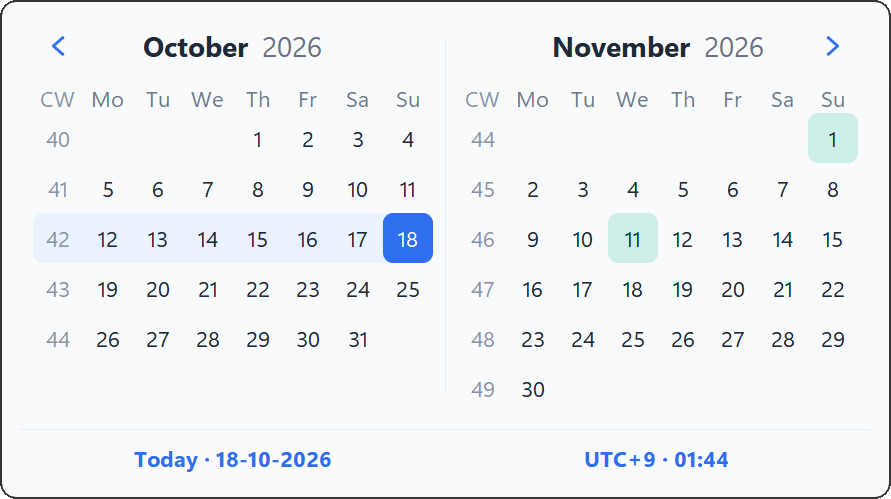

# WeekNumber v1.0

WeekNumber v1.0 is the first public release: the current ISO week in the
Windows notification area or the macOS menu bar, one click from a two-month
calendar with public holidays and a time-zone clock. It stays light, and it
cannot touch the network unless you allow it, each time.

## Downloads

| File | For |
|---|---|
| `WeekNumber.exe` | Windows 10 and 11 on x64; also runs on Windows 11 on ARM |
| `WeekNumber-arm64.exe` | Windows 11 on ARM, native |
| `WeekNumber.dmg` | macOS 12 or later on Apple silicon (M1 or newer) |

The legal notices and the licenses of everything inside each app are under
**About → Legal notices**.

**Windows:** put `WeekNumber.exe` in `C:\Program Files\WeekNumber` (needs
administrator rights), or in `%LOCALAPPDATA%\Programs\WeekNumber` if you
can't install software, and run it there. Run at Startup is refused from
Downloads, the Desktop, temporary or synced folders, network shares and
removable drives.

**macOS:** open the disk image, drag `WeekNumber.app` to Applications and
open it there. The app is not notarized by Apple yet, so macOS blocks the
first launch: open **System Settings → Privacy & Security** and click **Open
Anyway** (on macOS 14 and earlier, Control-click the app and choose
**Open**). The week number appears in the menu bar; the app has no Dock icon.

## Highlights

- **ISO-8601 weeks:** consistent week numbers and week-years, also across New
  Year.
- **Two-month calendar:** one click opens it, one more closes it; right-click
  a date or week number to copy it.
- **Public holidays:** nationwide holidays for up to two countries, offline.
- **Time-zone clock:** pick any city from a colourful world map.
- **Make it yours:** WeekNumber's own colour picker with 36 standard colours,
  bold digits, light or dark mode.
- **No network unless you allow it:** WeekNumber blocks every Internet
  connection from the moment it starts. The one optional extra that can
  connect asks each time it opens.
- **Light:** only the tray loads at start-up, and closed windows give their
  memory back; on macOS the app starts at about 40 MB.
- **Legal notices:** About → Legal notices shows the license and warranty,
  trademarks, privacy and encryption notices, then every license.

## Screenshots

## For builders

- Built with Python 3.15 from `requirements-release.lock`, which pins every
  dependency with its hash. `build_exe.bat` builds for the running Python's
  architecture (x64 or ARM64) and refuses 32-bit Python; both exes have
  encrypted chat (PyNaCl and libsodium).
- `build_app.sh` builds `WeekNumber.app` and `WeekNumber.dmg`, reports the
  architecture and warns about an x86_64 Python under Rosetta.
- Both scripts bundle `Licenses.txt`, written by `collect_licenses.py` with
  `docs/LEGAL_NOTICES.md` first.
- The online relay is the Cloudflare Worker in `relay/` (`tzd-relay`,
  `RELAY_URL` in `weeknumber_tzd_relay.py`). Deploy it before publishing;
  see `relay/README.md`.

## Source

This release is identified in the application, the Windows version resource
and the macOS bundle as **1.0**. The full list of changes is in
[`CHANGELOG.md`](../CHANGELOG.md).
